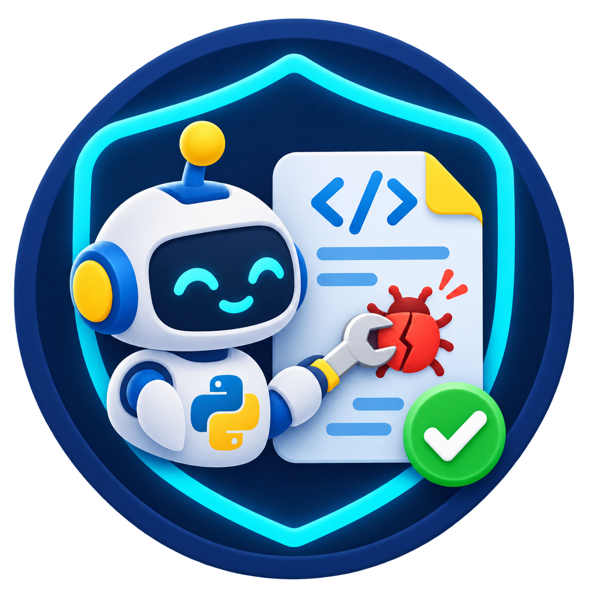

<h1 align="center">Python Repair Agent Lab: Pre-lab Setup</h1>

<p align="center">
  <strong>Software Engineering for AI</strong><br>
  Course team: Emad Shihab, Mahi Begoug, and Musfiqur Rahman
</p>

<p align="center">
  
</p>

Complete this page before the lab. Allow 45 to 60 minutes, plus the initial
local-model download if you choose Ollama. The goal is simple: arrive with the
tools, accounts, and connections already checked. Downloads, sign-in, and
Internet access can be slow or unavailable at the wrong moment; completing
these checks early protects the laboratory time. You will not build the repair
agent or run an evaluation project on this page.

## What each thing is for

The lab uses four different kinds of tool. Keeping their roles separate avoids
a common confusion.

| Item | Its role in this activity |
| --- | --- |
| A vibe-coding assistant | Helps you create and review the lab code. Choose Codex, Claude Code, or Cursor. It is not the model that your repair agent calls. |
| A repair-model route | Supplies the live model response during the lab. Prefer local Ollama with Qwen; use one cloud API only if local storage or memory is not sufficient. |
| GitHub | Stores your work. A separate, restricted token can later support bounded code research. |
| Langfuse Cloud | Can record the public repair trajectory for later inspection. |

The required scripted checkpoints work without a live LLM. We nevertheless
prepare a live-model route, GitHub, and Langfuse now so that optional work does
not turn into account setup during the lab.

> **Cost and credential rule.** We strongly recommend local Ollama and
> `qwen2.5-coder:7b`. If your computer cannot store or run it, you may choose a
> cloud provider. You are responsible for creating that account, accepting its
> terms, and every charge to its payment method or credits. Never put a key or
> token in a Git commit, source file, screenshot, or chat with a coding
> assistant.

## Preparation flow

Sign in to your GitHub account in a browser before starting. You do not need to
fork or clone the repository today.

```mermaid
flowchart LR
    tools["(1) Install Git, Python, Docker"] --> python["(2) Prepare a small Python environment"]
    python --> vibe["(3) Sign in to one vibe-coding assistant"]
    vibe --> model["(4) Test local Ollama or one cloud API"]
    model --> github["(5) Test a restricted GitHub token"]
    github --> langfuse["(6) Test Langfuse Cloud"]
    langfuse --> ready["(7) Final readiness check"]

    classDef toolBox fill:#dbeafe,stroke:#2563eb,color:#172554
    classDef setupBox fill:#ffedd5,stroke:#ea580c,color:#7c2d12
    classDef modelBox fill:#dcfce7,stroke:#16a34a,color:#14532d
    classDef serviceBox fill:#fef3c7,stroke:#d97706,color:#78350f
    classDef checkBox fill:#e0f2fe,stroke:#0284c7,color:#0c4a6e

    class tools toolBox
    class python,vibe setupBox
    class model modelBox
    class github,langfuse serviceBox
    class ready checkBox
```



## 1. Install and check the local tools

Install any missing tool using its official page, then close and reopen the
terminal before checking it.

| Tool | Official installation page | Successful check |
| --- | --- | --- |
| Git | [git-scm.com/downloads](https://git-scm.com/downloads/) | `git --version` prints a version. |
| Python | [python.org/downloads](https://www.python.org/downloads/) | Version is 3.11 or newer. |
| Docker on macOS | [Docker Desktop for Mac](https://docs.docker.com/desktop/setup/install/mac-install/) | `docker info` prints a **Server** section. |
| Docker on Windows | [Docker Desktop for Windows](https://docs.docker.com/desktop/setup/install/windows-install/) | `docker info` prints a **Server** section. |
| Docker on Linux | [Docker Desktop for Linux](https://docs.docker.com/desktop/setup/install/linux/) or a working course-provided Docker Engine | `docker info` prints a **Server** section. |

Run the checks that match your operating system.

**macOS or Linux**

```bash
git --version
python3 --version
docker info
```

**Windows PowerShell**

```powershell
git --version
py --version
docker info
```

Start Docker Desktop before running `docker info`. The command must finish
without an error and show information under **Server**. On Windows, Docker
Desktop normally uses Linux containers through WSL 2. If your computer is
managed by an institution or virtualization is disabled, ask for help before
the lab rather than replacing Docker with host Python.

## 2. Prepare a small Python environment for connection checks

This readiness check does not require a repository. For today's cloud and
Langfuse checks, create a temporary folder anywhere convenient, then create a
small virtual environment inside it.

**macOS or Linux**

```bash
mkdir coding-agent-lab-prelab
cd coding-agent-lab-prelab
python3 -m venv .venv
source .venv/bin/activate
python -m pip install --upgrade pip
python -m pip install "openai>=1,<3" "google-genai>=1,<2" "langfuse>=5,<6"
python -m pip check
```

**Windows PowerShell**

```powershell
mkdir coding-agent-lab-prelab
cd coding-agent-lab-prelab
py -m venv .venv
.\.venv\Scripts\Activate.ps1
python -m pip install --upgrade pip
python -m pip install "openai>=1,<3" "google-genai>=1,<2" "langfuse>=5,<6"
python -m pip check
```

If PowerShell blocks activation, run this once in the current PowerShell window
and then activate the environment again:

```powershell
Set-ExecutionPolicy -Scope Process -ExecutionPolicy Bypass
```

Expected outcome: `python -m pip check` reports no broken requirements. This
environment is only for the connection checks on this page.

## 3. Prepare one vibe-coding assistant

Choose one assistant and sign in before the lab. Any of these is suitable:

- [Codex](https://developers.openai.com/codex/)
- [Claude Code](https://code.claude.com/docs/en/overview)
- [Cursor](https://cursor.com/downloads)

Open the temporary `coding-agent-lab-prelab` folder in the selected tool. Send
this safe first message:

```text
Reply exactly: VIBE READY. Do not create or modify files.
```

Success means the assistant replies `VIBE READY` without asking you to sign in.
During the lab, it will help you create the agent; it does not replace the
repair model described next.

## 4. Choose and test one repair-model route

Choose one route. Route A is strongly preferred because it keeps the repair
model on your computer. Route B is a fallback only for machines with limited
storage or memory. This test asks a model for a short text response; it does
not run project code.

### Route A: local Ollama with Qwen, preferred

Install Ollama from the [official download page](https://ollama.com/download).
After installation, open a new terminal and run:

```bash
ollama --version
ollama pull qwen2.5-coder:7b
ollama run qwen2.5-coder:7b "Reply exactly: OLLAMA READY"
```

The download is roughly 5 GB and the first response may take longer than later
ones. Success means the last command returns `OLLAMA READY` (minor punctuation
is harmless). Leave the model installed and verify it is visible:

```bash
ollama list
```

If the download, memory use, or response time is unacceptable, stop here and
use Route B. Do not spend the lab attempting to make an unsuitable local model
work.

### Route B: one cloud LLM API, fallback

Choose **one** provider, create an API key, and run its first-request test. A
successful request can consume credits. The provider account, API key, model
choice, and charges are your responsibility.

| Provider | Set up an account and key | Environment variables to set | First-request test |
| --- | --- | --- | --- |
| OpenAI API | Follow the [official Python quickstart](https://developers.openai.com/api/docs/quickstart) and create an API key in the linked Platform dashboard. | `OPENAI_API_KEY` and `OPENAI_MODEL` | Run the OpenAI command below. |
| Gemini API | Follow the [Gemini API getting-started guide](https://ai.google.dev/gemini-api/docs/get-started?lang=python) and create a key in Google AI Studio. | `GEMINI_API_KEY` and `GEMINI_MODEL` | Run the Gemini command below. |
| Vertex AI or another provider | Use that provider's official quickstart to create credentials and make one text request. | Follow that provider's documentation. | Keep its equivalent one-request proof for the instructor. |

Set a key only for the current terminal session. Replace the placeholders, but
never paste a real key into a source file. For `OPENAI_MODEL` or
`GEMINI_MODEL`, use the exact text-model identifier enabled in your own
provider account or playground.

**OpenAI, macOS or Linux**

```bash
export OPENAI_API_KEY="replace-with-your-key"
export OPENAI_MODEL="a-model-available-in-your-account"
python -c "from openai import OpenAI; import os; print(OpenAI().responses.create(model=os.environ['OPENAI_MODEL'], input='Reply exactly: API READY').output_text)"
```

**OpenAI, Windows PowerShell**

```powershell
$env:OPENAI_API_KEY="replace-with-your-key"
$env:OPENAI_MODEL="a-model-available-in-your-account"
python -c "from openai import OpenAI; import os; print(OpenAI().responses.create(model=os.environ['OPENAI_MODEL'], input='Reply exactly: API READY').output_text)"
```

**Gemini, macOS or Linux**

```bash
export GEMINI_API_KEY="replace-with-your-key"
export GEMINI_MODEL="a-model-available-in-your-account"
python -c "from google import genai; import os; print(genai.Client().interactions.create(model=os.environ['GEMINI_MODEL'], input='Reply exactly: API READY').output_text)"
```

**Gemini, Windows PowerShell**

```powershell
$env:GEMINI_API_KEY="replace-with-your-key"
$env:GEMINI_MODEL="a-model-available-in-your-account"
python -c "from google import genai; import os; print(genai.Client().interactions.create(model=os.environ['GEMINI_MODEL'], input='Reply exactly: API READY').output_text)"
```

Success means the command prints `API READY` or a clearly equivalent short
reply. A cloud key does not automatically add a cloud adapter to the lab. The
guided activity first defines one small `ChatClient` interface; after that, a
student who uses a cloud provider may ask their coding assistant to add one
adapter that satisfies that interface. Do not add that code during pre-lab
setup.

## 5. Prepare and test the GitHub research connection

The later GitHub extension is restricted to GitHub code search. It is not a
general browser. Create a separate, short-lived **fine-grained personal access
token** named `coding-agent-lab-research`. In GitHub: profile picture,
**Settings**, **Developer settings**, **Personal access tokens**,
**Fine-grained tokens**, then **Generate new token**. Use the smallest
permissions and shortest expiration that work; it must not have repository
write permission. GitHub's [personal-access-token guide](https://docs.github.com/en/authentication/keeping-your-account-and-data-secure/managing-your-personal-access-tokens)
explains these choices.

Set it only in the current terminal, then run this connection check:

**macOS or Linux**

```bash
export GITHUB_TOKEN="replace-with-your-token"
python -c "import json, os, urllib.request; request=urllib.request.Request('https://api.github.com/user', headers={'Authorization': 'Bearer ' + os.environ['GITHUB_TOKEN'], 'Accept': 'application/vnd.github+json'}); print('GITHUB READY:', json.load(urllib.request.urlopen(request, timeout=10))['login'])"
```

**Windows PowerShell**

```powershell
$env:GITHUB_TOKEN="replace-with-your-token"
python -c "import json, os, urllib.request; request=urllib.request.Request('https://api.github.com/user', headers={'Authorization': 'Bearer ' + os.environ['GITHUB_TOKEN'], 'Accept': 'application/vnd.github+json'}); print('GITHUB READY:', json.load(urllib.request.urlopen(request, timeout=10))['login'])"
```

Success prints `GITHUB READY:` followed by your GitHub login. The command does
not display the token. Do not use your normal Git password or a broad token.

## 6. Prepare and test Langfuse Cloud

This activity uses [Langfuse Cloud](https://cloud.langfuse.com), not a local or
self-hosted installation. Create an account, make one project, then create API
credentials in that project's settings. Set the key pair and the Cloud region
for the current terminal. The standard EU Cloud URL is shown below; use the URL
displayed by your own project if you selected another region.

**macOS or Linux**

```bash
export LANGFUSE_PUBLIC_KEY="replace-with-your-public-key"
export LANGFUSE_SECRET_KEY="replace-with-your-secret-key"
export LANGFUSE_BASE_URL="https://cloud.langfuse.com"
python -c "from langfuse import get_client; client=get_client(); assert client.auth_check(); print('LANGFUSE READY')"
```

**Windows PowerShell**

```powershell
$env:LANGFUSE_PUBLIC_KEY="replace-with-your-public-key"
$env:LANGFUSE_SECRET_KEY="replace-with-your-secret-key"
$env:LANGFUSE_BASE_URL="https://cloud.langfuse.com"
python -c "from langfuse import get_client; client=get_client(); assert client.auth_check(); print('LANGFUSE READY')"
```

Success prints `LANGFUSE READY`. The command only verifies credentials; do not
send source files, keys, or private test output to Langfuse.

## 7. Final readiness check

With the temporary `.venv` active and Docker running, run:

```bash
python --version
python -m pip check
docker info --format '{{.ServerVersion}}'
```

You are ready when all statements below are true:

- [ ] Python is version 3.11 or newer and `python -m pip check` reports no broken requirements.
- [ ] Docker prints a server version instead of an error.
- [ ] One vibe-coding assistant replies `VIBE READY` without modifying files.
- [ ] Local Ollama returns `OLLAMA READY`, **or** one cloud provider returns `API READY`.
- [ ] The GitHub connection prints your login.
- [ ] Langfuse Cloud prints `LANGFUSE READY`.
